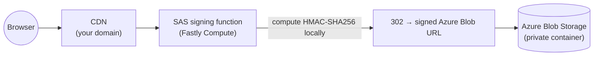

# Azure SAS signing at the edge



An Edge Function that signs **Azure Storage SAS** (Shared Access Signature) at the edge, so a site
fronted by the Adobe Managed CDN can serve assets from a **private Azure Blob container** without a
signing backend of its own. For each request under a protected path it mints a short-lived,
read-only SAS and (by default) redirects the browser to the signed blob URL.

This is a **delivery-agnostic** example — it is **neither** EDS-specific (`edge-delivery-*`) **nor**
AEM-CS-specific (`publish-delivery-*`). It signs requests to a customer's **own external Azure
store**, not to the AEM/EDS origin, so the same function works in front of an Edge Delivery site or
an AEM as a Cloud Service site.

> **Disclaimer.** This is an **informative reference**, not a required architecture. Reach for it
> when you specifically need to serve **private** third-party (Azure) storage through the CDN. On AEM
> as a Cloud Service, the CDN already serves AEM's **own DAM** assets via a built-in
> `302 → Azure SAS → blob` flow — that is a separate, platform-managed path, not this example.

## How SAS signing works (why it can be done locally)

Azure does **not** "issue" an account/service SAS. The `sig` is a plain **HMAC-SHA256 that the holder
of the storage account key computes** — Azure only re-computes it on the incoming request and
compares. It is a symmetric-key signature (like a JWT `HS256` or an AWS SigV4 signature), so it is
signable **at the edge with `crypto.subtle` and zero Azure round-trips**. No Azure SDK, no npm
dependencies — the official SDKs would not run in the Compute (WASM) sandbox anyway; this example
uses only Web Crypto, which the sandbox provides natively.

## Why no Azure SDK (hand-assembled with Web Crypto)

The signing lives in `src/lib/azure-sas.js` (and `src/lib/azure-delegation.js`) rather than in
`@azure/storage-blob`, for one decisive reason: the SDK's SAS generation
(`StorageSharedKeyCredential` / `generateBlobSASQueryParameters`) is **Node-only** — it uses
`node:crypto` and is deliberately excluded from the SDK's **browser** build — so it **cannot run** in
the Fastly Compute WASM / Web-API sandbox. This is a **compatibility** limit, not a size one: even
within the 100 MB compressed-package budget, the SDK simply would not execute here. There is no
official Microsoft library that signs SAS in a WinterCG/edge runtime, so assembling the token with
`crypto.subtle` is the standard approach (the same one used on Cloudflare Workers, Deno Deploy, etc.).

Signing a SAS is only an **HMAC-SHA256 over a documented string-to-sign** — the crypto is a single
standard call; the one detail we own is the field order, taken verbatim from the Azure spec and
**pinned by unit tests** (`test/azure-sas.test.js`) with known-answer vectors.

**Tradeoff (worth stating):** an SDK would track spec changes for you, whereas this code is pinned to
a signed version. That is safe because the SAS format is **versioned by the `sv` parameter** — each
version has a fixed, documented layout and Azure keeps older versions working. So a pinned
`SIGNED_VERSION` stays stable indefinitely; moving to a newer `sv` (to pick up new fields) is a
**deliberate** change — update the field lists in `azure-sas.js` and the tests — never a silent break.

## What it does

For each request routed to it (see [CDN routing](#cdn-routing)):

1. Checks the path is under `PROTECTED_PREFIX` (`src/config.js`) — else `404`.
2. Derives the blob name from the path (`/secure-assets/reports/q1.pdf` → `reports/q1.pdf`).
3. Reads the **account key** from the Secret Store (imported once per instance).
4. Builds the Azure **service SAS** string-to-sign and signs it with HMAC-SHA256 (`src/lib/azure-sas.js`).
5. Delivers the asset — **`redirect`** mode (default) responds `302` to the signed Azure Blob URL;
   **`proxy`** mode fetches the blob with the SAS and streams it back under your domain.

## Credential variants — switch with `AUTH_MODE`

Both variants are implemented; select one with `AUTH_MODE` in `src/config.js`.

| Variant (`AUTH_MODE`) | Secret held | Azure round-trip | Posture |
|---|---|---|---|
| **`account-key`** (default) | storage **account key** (key1/key2) | **none** — sign locally forever | simplest; the full-access master key lives in the Secret Store |
| **`user-delegation`** | an **Entra service principal** | one cacheable OAuth → `getUserDelegationKey` (key valid ≤ 7 days) | no master key at the edge; **RBAC-scoped**, revocable — Azure's recommended pattern |

**`account-key`** — set `ACCOUNT_KEY_SECRET` to the Secret Store entry holding the base64 account
key. The function HMACs each request locally; zero Azure calls.

**`user-delegation`** — set `AZURE_TENANT_ID`, `AZURE_CLIENT_ID`, and `SP_CLIENT_SECRET` (the Secret
Store entry with the service-principal client secret). The SP needs a role such as **Storage Blob
Delegator** on the account/container. At runtime the function (`src/lib/azure-delegation.js`):
1. gets an Entra OAuth token (SP client-credentials, scope `https://storage.azure.com/.default`),
2. calls `getUserDelegationKey` for a key valid up to `DELEGATION_KEY_TTL_SECONDS` (≤ 7 days),
3. **caches** both (module scope) and refreshes only near expiry — so almost every request just
   HMACs locally with the cached delegation key,
4. signs the user-delegation string-to-sign (which carries the delegation-key identity
   `skoid/sktid/skt/ske/sks/skv`).

This variant needs the `azure-login` and `azure-blob` origins declared as backends
(`config/edgeFunctions.yaml` / `fastly.toml`); the account-key variant in `redirect` mode needs
neither. The signing math is shared — only the key source (and the periodic refresh) differ.

## Configuration

Non-secret runtime settings live in the **Config Store** — set them in
`config/edgeFunctions.yaml` under `configs:` (per environment, no code change). `src/config.js` reads
them via `ConfigStore('config_default')` and only supplies fallback defaults. `fastly.toml` seeds the
same values for local `serve`.

| `configs:` key | Meaning |
|---|---|
| `AUTH_MODE` | `account-key` (default) or `user-delegation` |
| `AZURE_STORAGE_ACCOUNT` / `AZURE_BLOB_CONTAINER` | your account + private container |
| `PROTECTED_PREFIX` | path prefix that is signed (keep in sync with `config/cdn.yaml`) |
| `MODE` | `redirect` (default) or `proxy` |
| `SAS_TTL_SECONDS` | SAS validity (short — it is a bearer credential) |
| `SAS_PERMISSIONS` | `r` = read-only (default) |
| `SIGNED_VERSION` | Azure `sv` (2020-12-06+) |
| `AZURE_TENANT_ID` / `AZURE_CLIENT_ID` | (`user-delegation`) Entra SP identity — **not secrets** (public identifiers) |
| `DELEGATION_KEY_TTL_SECONDS` | (`user-delegation`) how long each delegation key is requested for (≤ 7 days) |

**Secrets** (the account key or the SP client secret) live in the **Secret Store**, declared under
`secrets:` in `config/edgeFunctions.yaml` as `${{…}}` references — injected at deploy time, read at
runtime, never in this repo. Their entry names (`AZURE_STORAGE_ACCOUNT_KEY`, `AZURE_SP_CLIENT_SECRET`)
and the backend/origin names are the only Azure-related constants left in `src/config.js`, because
they must match the YAML declarations.

### Key rotation

Azure storage accounts have two keys (key1/key2). To rotate without downtime, sign with the current
key, and when you roll to the other key in Azure, update the Cloud Manager secret and re-deploy. For
zero-gap rotation you can extend `getAccountSigningKey()` (`src/sign.js`) to try a primary then a secondary
secret.

## CDN routing

`config/cdn.yaml` routes only the protected path space to the function via an origin selector:

```yaml
- name: route-to-azure-sas-signing
  when:
    allOf:
      - { reqProperty: tier, equals: "publish" }
      - { reqProperty: domain, equals: "www.example.com" }
      - { reqProperty: method, in: ["GET", "HEAD"] }
      - { reqProperty: originalPath, matches: '^/secure-assets/' }
  action:
    type: selectAemOrigin
    originName: edgefunction-azure-sas-signing
```

Route **only** the protected space — the function `404`s everything else, and you do not want
unrelated traffic paying the function hop.

## Caching

In `redirect` mode the `302` is cacheable up to just under the SAS TTL (`public, max-age = TTL − 30`)
so a shared cache never hands out a URL past its `se=` expiry. The signed asset itself is cached by
Azure and the CDN. In `proxy` mode the blob response is cached at the edge for the same bounded TTL.

## Security notes

- The account key is a **full-access** credential — keep it only in the Secret Store, use short TTLs,
  and prefer the user-delegation variant for least privilege.
- The SAS is a **bearer** token in a URL — short `se=`, `spr=https`, and optionally `sip=` (client IP)
  bound its blast radius.
- Never log the key or the raw `sig`.

## Project layout

| Path | Role |
|------|------|
| `src/index.js` | `fetch` entry; delegates to the handler, logs, wraps errors |
| `src/sign.js` | reads the key (once/instance), builds the SAS, redirects or proxies |
| `src/lib/azure-sas.js` | **pure** SAS string-to-sign + HMAC-SHA256 (Web Crypto) — account-key + user-delegation, unit-tested |
| `src/lib/azure-delegation.js` | runtime OAuth + `getUserDelegationKey` fetch + caching (user-delegation mode) |
| `src/config.js` | reads runtime config from the Config Store (defaults + secret/backend name constants) |
| `config/edgeFunctions.yaml` | declares the function + account-key secret + Azure origin |
| `config/cdn.yaml` | origin selector routing the protected path to the function |
| `test/azure-sas.test.js` | string-to-sign + known-answer HMAC + URL assembly tests |

## Run it locally

```bash
npm install
npm test                        # unit-test the signing math
aio aem edge-functions serve    # or: fastly compute serve  (http://127.0.0.1:7676)
curl -si 'http://127.0.0.1:7676/secure-assets/reports/q1.pdf'   # 302 with a signed Location
```

`fastly.toml` seeds a **dummy** local account key so `serve` works offline; the redirect it produces
will not validate against real Azure until you supply your account, container, and a real key. Unit
tests use a fixed non-secret key and assert a stable string-to-sign + HMAC known-answer.

> **Note on correctness.** The string-to-sign follows the Azure REST spec exactly, and the tests pin
> its field order and a deterministic HMAC. Final validation against a live storage account (or a
> vector from the official `azure-storage` SDK) is recommended before production use.

## Build & deploy

```bash
aio aem edge-functions build
aio aem edge-functions deploy azure-sas-signing
```

## References

- [Create a service SAS](https://learn.microsoft.com/rest/api/storageservices/create-service-sas)
- [Create a user delegation SAS](https://learn.microsoft.com/rest/api/storageservices/create-user-delegation-sas)
- [Fastly Compute JavaScript](https://www.fastly.com/documentation/guides/compute/javascript/)
